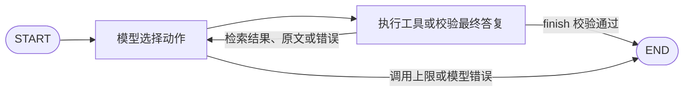

# 企业知识问答 Agent

一个小型 LangGraph 决策循环：模型每轮选择从`search_documents`、`read_document` 或 `finish`里选择一个动作，程序执行动作并把结果作为 `ToolMessage` 交回模型。下一轮可改写检索、读取其他原文、追问或结束。所有 Prompt 和工具描述均为英语；答复跟随用户语言。

本项目使用 CLI、本地 JSON 和单模型。



## 安装与配置

已在 Python 3.14.4 / Windows PowerShell 环境验证。项目根目录运行：

```powershell
py -3.14 -m venv .venv
.\.venv\Scripts\python.exe -m pip install -e ".[dev]"
```

在 `.env` 填写 `LLM_API_KEY`、`LLM_MODEL` 和 `LLM_PROVIDER`。模型必须支持 Chat Completions 工具调用。

当前用的是 **OpenRouter** 模型：

```dotenv
LLM_PROVIDER=openrouter
LLM_API_KEY=OpenRouter密钥
LLM_BASE_URL=https://openrouter.ai/api/v1
LLM_MODEL=openrouter/free
```

程序使用 `langchain-openrouter` 的 `ChatOpenRouter` 直接接入 OpenRouter。
`openrouter/free` 会由服务端选择支持请求功能的免费模型，每步实际模型记录于 `trace.actual_model`。
若希望固定模型，可把 `LLM_MODEL` 换成当前可用且支持工具调用的模型 ID。

当前只接入 OpenRouter。OpenRouter 默认将请求间隔设为至少 4 秒，以减少短时限流。

若返回 `TooManyRequestsResponseError`，检查账户免费请求额度，每日额度（约55次请求）耗尽需要等待额度重置。额度规则见 [OpenRouter 官方说明](https://openrouter.ai/docs/api/reference/limits)。

默认 `MAX_MODEL_CALLS=10`、`MAX_TOOL_CALLS=8`。

## 运行

```powershell
.\.venv\Scripts\python.exe -m kb_agent --question "年假要提前多久申请？" --trace examples/live/trace.json
.\.venv\Scripts\python.exe -m kb_agent --question "报销期限多久？"
.\.venv\Scripts\python.exe -m kb_agent --question "那谁来审批？" --history examples/history.json
```

输出含 `result.answer`、`citations`（文档 ID、片段 ID、版本日期、原文）、`conflicts`、`gaps`、`follow_up`、`status`，并提供调用计数和结束原因。`--trace` 保存完整工具观察和简短动作依据。

| 状态 | 含义 |
| --- | --- |
| `answered` | 有原文支持的答复 |
| `needs_clarification` | 请求确认适用制度或问题含义 |
| `insufficient_evidence` | 成功检索后，现有资料仍缺少答案 |
| `tool_error` | 工具或模型服务错误妨碍完成 |
| `incomplete` | 达到调用上限，或尚未完成 |

`finish` 也占一个工具调用，失败的单工具动作也计数。
退出码：正常业务结果为 0，`incomplete` / `tool_error` 为 2。

## 验证与运行

```powershell
# 两条真实路径
.\.venv\Scripts\python.exe -m kb_agent.evaluate --cases T01 T02

# 完整 8 项验收
.\.venv\Scripts\python.exe -m kb_agent.evaluate --output examples/live/full-run
```

真实模型脚本为每个用例输出一个 `Txx.json`，并输出本次运行的 `summary.json` 汇总。

用例配置在 examples/cases/acceptance.json。

## 资料替换与故障注入

```powershell
.\.venv\Scripts\python.exe -m kb_agent --question "年假要提前多久申请？" --documents data/variants/annual_leave_5_days.json
.\.venv\Scripts\python.exe -m kb_agent --question "报销期限多久？" --documents data/variants/without_d02.json
.\.venv\Scripts\python.exe -m kb_agent --question "年假要提前多久申请？" --failure-mode read_once
```

LocalTools [knowledge.py] 模拟工具故障的逻辑，只返回错误，是否重试由下一轮模型决定。
对话历史只用于理解上下文，不能代替本次读取的证据，回答引用必须来自本次成功读取的文档。
